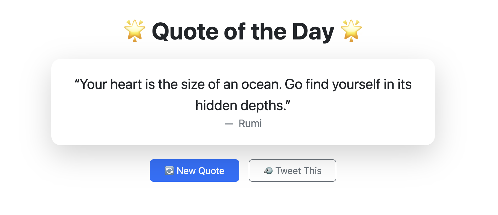

# Quote of the Day — Angular 21 + Bootstrap 5.3.8


A lightweight Angular application that displays a random inspirational quote using the DummyJSON Quotes API. Each request fetches a new quote, avoids repeating the previous one, and updates the UI with a smooth loading state.

## Features

- Angular 21 standalone application
- Bootstrap 5.3.8 responsive UI
- Fetches a random quote from 1,454 available quotes
- Prevents showing the same quote twice in a row
- Loading spinner while retrieving data
- Clean card layout with author attribution
- One‑click “Tweet This” sharing
- Prettier formatting for Angular templates

## Tech Stack

- Angular 21
- TypeScript
- Signals API
- DummyJSON Quotes API
- Standalone Components

## Screenshot



## Installation

```bash
git clone https://github.com/iNoles/quote-day-angular
cd quote-day-angular
npm install
```

### Running the App

Start the development server:
```bash
ng serve
```

Then open:
```
http://localhost:4200
```

### Building The App

To build the project run:

```bash
ng build
```

This will compile your project and store the build artifacts in the `dist/` directory. By default, the production build optimizes your application for performance and speed.
